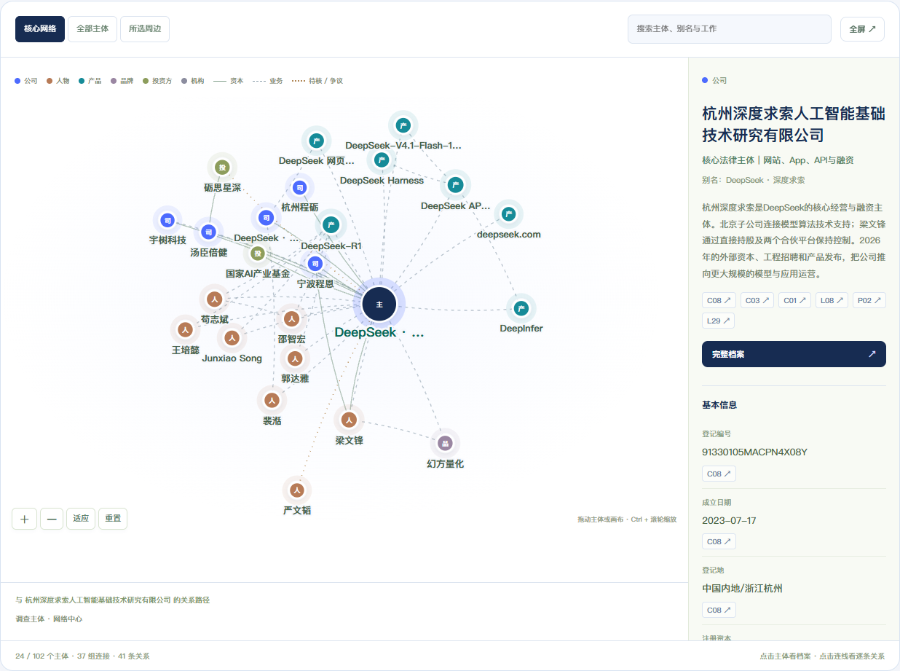

<picture>
  <source media="(prefers-color-scheme: dark)" srcset="assets/brand/header-dark.svg">
  
</picture>

  <a href="README.md">简体中文</a> &nbsp; / &nbsp; <strong>English</strong>

Reusable AI skills for everyday work.

  <a href="#categories">Categories</a> &nbsp; · &nbsp;
  <a href="#skills">Skill catalog</a> &nbsp; · &nbsp;
  <a href="#previews">Previews</a> &nbsp; · &nbsp;
  <a href="#maintain">Contribute</a>

## Browse by field

<table>
<tr>
<td width="600" valign="top">
  01 / LEGAL 
  <h3><a href="skills/legal/">Legal &amp; Compliance →</a></h3>
  
Find laws and case law, assess compliance, and draft legal documents.

</td>
<td width="600" valign="top">
  02 / DEVELOPMENT 
  <h3><a href="skills/development/">Technology &amp; Development →</a></h3>
  
Develop, debug, deploy, and automate software.

</td>
</tr>
<tr>
<td width="600" valign="top">
  03 / OPERATIONS 
  <h3><a href="skills/operations/">Business &amp; Product Operations →</a></h3>
  
Analyze competitors, plan campaigns, support growth, and improve workflows.

</td>
<td width="600" valign="top">
  04 / INVESTIGATION 
  <h3><a href="skills/investigation/">Company Investigations →</a></h3>
  
Verify companies, ownership, key people, and product operations.

</td>
</tr>
<tr>
<td width="600" valign="top">
  05 / RESEARCH 
  <h3><a href="skills/research/">Academic Research →</a></h3>
  
Review literature, design studies, write papers, and prepare research proposals.

</td>
<td width="600" valign="top">
  06 / PUBLISHING 
  <h3><a href="skills/publishing/">Writing &amp; Publishing →</a></h3>
  
Write, edit, format, and publish content across platforms.

</td>
</tr>
<tr>
<td width="600" valign="top">
  07 / DESIGN 
  <h3><a href="skills/design/">Design &amp; Visuals →</a></h3>
  
Create covers, illustrations, infographics, and interactive presentations.

</td>
<td width="600" valign="top">
  ＋ / CONTRIBUTE 
  <h3><a href="docs/maintenance.en.md">Add or update a skill →</a></h3>
  
Share the skill files and their purpose. Let an AI agent organize and commit them.

</td>
</tr>
</table>

## Skill catalog

| Category | Skill | What it does | Output |
| --- | --- | --- | --- |
| [Company Investigations](skills/investigation/) | [Company Background Investigation](skills/investigation/company-background-investigation/SKILL.md) | Verify company identities, key people, ownership, funding, and product operations to support employment, partnership, and investment research. | Offline interactive HTML, relationship graph, structured research data, and evidence manifest |

## Previews

### [Company Background Investigation](skills/investigation/company-background-investigation/SKILL.md)

The DeepSeek report's relationship network connects the company to people, capital, and products, with linked entity profiles.

Explore full examples: [DeepSeek](https://research.zrainbow1257.com/reports/deepseek/) · [Tipsy](https://research.zrainbow1257.com/reports/tipsy/) · [MiniMax](https://research.zrainbow1257.com/reports/minimax/)

## Add & maintain

Share a skill folder, ZIP, or `SKILL.md` with an AI agent, along with the repository link. Follow the maintenance guide to organize the files, update both catalogs, and commit the changes.

[Add, update & transfer →](docs/maintenance.en.md) &nbsp; · &nbsp; [Agent instructions](AGENTS.md)
