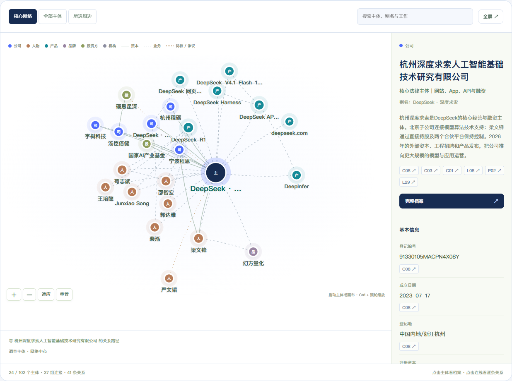

<picture>
  <source media="(prefers-color-scheme: dark)" srcset="assets/brand/header-dark.svg">
  
</picture>

  <strong>简体中文</strong> &nbsp; / &nbsp; <a href="README.en.md">English</a>

把日常工作中反复用到的方法，整理成可复用的 AI Skills。

  <a href="#categories">分类导航</a> &nbsp; · &nbsp;
  <a href="#skills">技能目录</a> &nbsp; · &nbsp;
  <a href="#previews">作品预览</a> &nbsp; · &nbsp;
  <a href="#maintain">添加与维护</a>

## 分类导航

<table>
<tr>
<td width="600" valign="top">
  01 / LEGAL 
  <h3><a href="skills/legal/">法律与合规 →</a></h3>
  
法规与判例检索、合规分析、法律写作。

</td>
<td width="600" valign="top">
  02 / DEVELOPMENT 
  <h3><a href="skills/development/">技术与开发 →</a></h3>
  
软件开发、调试、部署与自动化。

</td>
</tr>
<tr>
<td width="600" valign="top">
  03 / OPERATIONS 
  <h3><a href="skills/operations/">公司与产品运营 →</a></h3>
  
竞品分析、活动策划、用户增长与业务流程。

</td>
<td width="600" valign="top">
  04 / INVESTIGATION 
  <h3><a href="skills/investigation/">公司调查 →</a></h3>
  
核验公司主体、股权、人物与产品运营。

</td>
</tr>
<tr>
<td width="600" valign="top">
  05 / RESEARCH 
  <h3><a href="skills/research/">学术研究 →</a></h3>
  
文献整理、研究设计、论文与课题申报。

</td>
<td width="600" valign="top">
  06 / PUBLISHING 
  <h3><a href="skills/publishing/">写作与发布 →</a></h3>
  
写作编辑、注释排版与多平台发布。

</td>
</tr>
<tr>
<td width="600" valign="top">
  07 / DESIGN 
  <h3><a href="skills/design/">设计与视觉 →</a></h3>
  
封面配图、信息图、视觉策划与交互展示。

</td>
<td width="600" valign="top">
  ＋ / CONTRIBUTE 
  <h3><a href="docs/maintenance.md">添加或更新 Skill →</a></h3>
  
提供技能文件与用途，交给 AI 归类、整理和提交。

</td>
</tr>
</table>

## 技能目录

| 分类 | Skill | 解决的问题 | 产出 |
| --- | --- | --- | --- |
| [公司调查](skills/investigation/) | [公司深度背景调查](skills/investigation/company-background-investigation/SKILL.md) | 核验公司主体、人物、股权、资金与产品运营，为入职、合作和投资研究建立可追溯的事实基础。 | 离线交互式 HTML、关系图谱、结构化调查数据与证据清单 |

## 作品预览

### [公司深度背景调查](skills/investigation/company-background-investigation/SKILL.md)

DeepSeek 报告中的关系网络：从公司出发查看人物、资本与产品连接，并打开对应主体档案。

查看完整案例：[DeepSeek](https://research.zrainbow1257.com/reports/deepseek/) · [Tipsy](https://research.zrainbow1257.com/reports/tipsy/) · [MiniMax](https://research.zrainbow1257.com/reports/minimax/)

## 添加与维护

把技能文件夹、ZIP 或 `SKILL.md` 交给 AI，附上仓库链接，按维护说明归类、更新双语目录并提交。

[添加与传输 →](docs/maintenance.md) &nbsp; · &nbsp; [维护规则](AGENTS.md)

## Thanks
[Linux Do](https://linux.do) 社区的帮助
